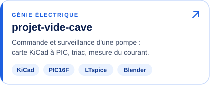
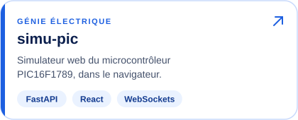
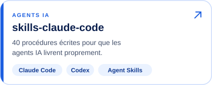
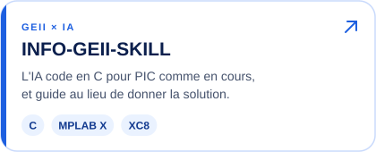

  
  
  

Étudiant en **2e année de BUT GEII** (génie électrique et informatique industrielle),
je cherche un **stage en génie électrique d'avril à mai 2027**. À côté des études, je
conçois des sites et des automatisations en pilotant des agents IA, sous le nom **RGM Dev**.

## Projets

<!-- Images à largeur fixe plutôt qu'un tableau : deux par ligne sur ordinateur,
     une par ligne sur téléphone, où le tableau rendait le texte illisible. -->

  
  
  
  

## Outils

**Électronique** 

**Web** 

**Agents IA** 

## Langages

## Ma règle de travail

> Rien n'est annoncé sans preuve : un test vert, une mesure, une capture.
> Un agent IA va vite ; il devient fiable quand il sait ce qu'il doit prouver et où il doit s'arrêter.
