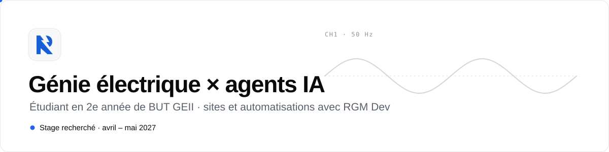
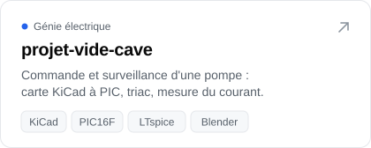
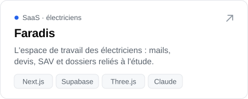
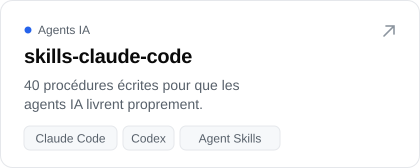
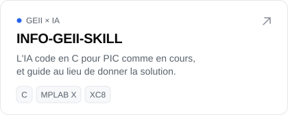

<a href="https://www.rafaelgmille.site">
  <picture>
    <source media="(prefers-color-scheme: dark)" srcset="assets/banniere-sombre.svg">
    
  </picture>
</a>

  <a href="https://www.rafaelgmille.site"><b>Portfolio</b></a> ·
  <a href="https://www.rafaelgmille.site/stack">Ma stack et ma méthode</a> ·
  <a href="https://www.rgm-dev.site">RGM Dev</a>

Étudiant en **2e année de BUT GEII** (génie électrique et informatique industrielle),
je cherche un **stage en génie électrique d'avril à mai 2027**. À côté des études, je
conçois des sites et des automatisations en pilotant des agents IA, sous le nom **RGM Dev**.

## Projets

<!-- Images à largeur fixe plutôt qu'un tableau : deux par ligne sur ordinateur,
     une par ligne sur téléphone. Chaque carte existe en clair et en sombre. -->

  <a href="https://github.com/glm02/projet-vide-cave"><picture><source media="(prefers-color-scheme: dark)" srcset="assets/carte-vide-cave-sombre.svg"></picture></a>
  <a href="https://faradis.vercel.app"><picture><source media="(prefers-color-scheme: dark)" srcset="assets/carte-faradis-sombre.svg"></picture></a>
  <a href="https://github.com/glm02/skills-claude-code"><picture><source media="(prefers-color-scheme: dark)" srcset="assets/carte-skills-sombre.svg"></picture></a>
  <a href="https://github.com/glm02/INFO-GEII-SKILL"><picture><source media="(prefers-color-scheme: dark)" srcset="assets/carte-info-geii-sombre.svg"></picture></a>

## Outils

**Électronique** 

**Web** 

**Agents IA** 

## Langages

<a href="https://github.com/glm02?tab=repositories">
  <picture>
    <source media="(prefers-color-scheme: dark)" srcset="https://github-readme-stats.vercel.app/api/top-langs/?username=glm02&layout=compact&langs_count=8&disable_animations=true&bg_color=0d1117&border_color=30363d&title_color=f0f6fc&text_color=9198a1&border_radius=12&custom_title=Langages%20les%20plus%20utilis%C3%A9s">
    
  </picture>
</a>

## Ma règle de travail

> Rien n'est annoncé sans preuve : un test vert, une mesure, une capture.
> Un agent IA va vite ; il devient fiable quand il sait ce qu'il doit prouver et où il doit s'arrêter.
